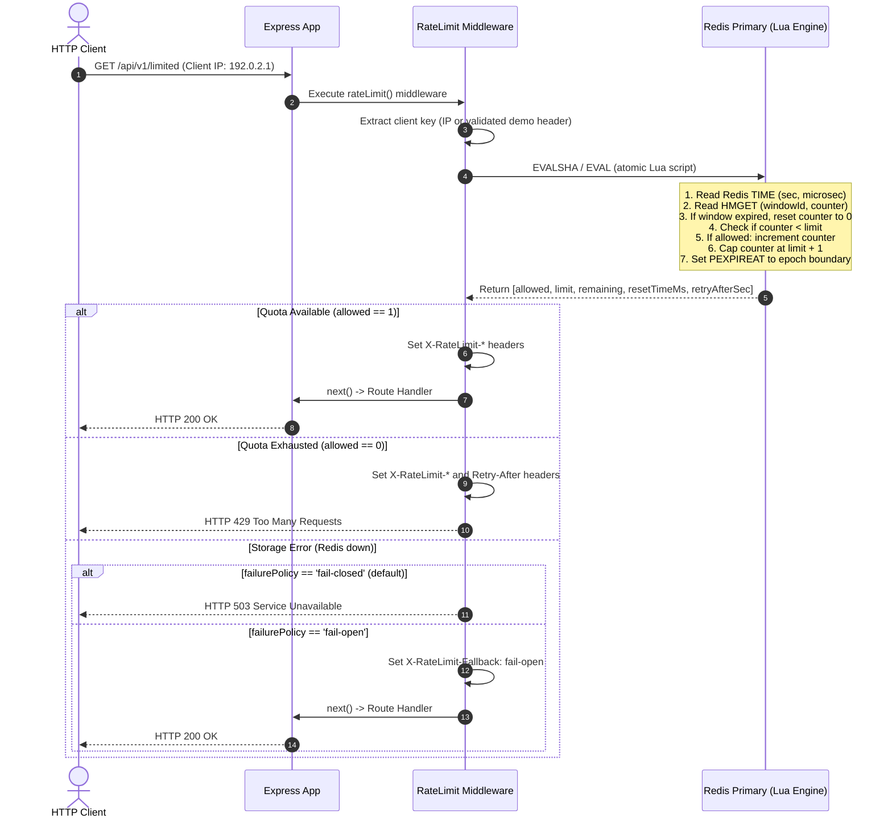

# Rate Limiting Laboratory (`rate-limiting-lab`)

A production-minded reference laboratory and verification harness for rate limiting architectures built with **TypeScript**, **Node.js**, and **Redis**.

This repository provides working, verified implementations of distributed and in-memory rate limiting algorithms, accompanied by deterministic test suites, architectural decision records (ADRs), adversarial mutation experiments, and empirical benchmark harnesses.

---

## 1. What This Laboratory Demonstrates (and What It Does Not Claim)

### Demonstrates:

- **Atomic Distributed Enforcement:** A distributed Fixed Window rate limiter backed by a single-key Redis Lua state machine (`HMGET`, `HSET`, `PEXPIREAT`), eliminating concurrency race conditions on a single active Redis primary node under concurrent burst traffic.
- **Single Time Authority & Exact Expiration:** Uses Redis server time (`TIME`) to eliminate distributed epoch skew and sets absolute key expiration (`PEXPIREAT`) at the exact epoch boundary `(windowId + 1) * windowMs` without a safety buffer.
- **Resilient Failure Policies:** Separately configurable and tested **fail-closed** (HTTP 503 default protecting downstream dependencies) and **fail-open** (delegation with diagnostic telemetry headers) behavior during storage outages.
- **Reference Algorithm Implementations:** Deterministic, in-memory implementations of four core rate limiting algorithms:
  1. Fixed Window Counter
  2. Token Bucket (with continuous fractional accrual and exact refill boundaries)
  3. Sliding Window Log (exact rolling window; per-client timestamp log is bounded by the limit since rejected requests are not stored, but total memory is proportional to active client-key cardinality $O(K \times L)$)
  4. Sliding Window Counter (weighted rolling average with mathematically derived next-epoch admission)
- **Production HTTP Middleware:** An Express middleware pipeline enforcing headers: standards-defined `429 Too Many Requests` (RFC 6585) and `Retry-After` (RFC 9110), alongside widely adopted de facto convention headers (`X-RateLimit-Limit`, `X-RateLimit-Remaining`, `X-RateLimit-Reset`), defending against client header spoofing (`X-Forwarded-For`).
- **Reproducible Evidence:** 103 automated tests across unit, contract, and live Redis integration suites, plus documented controlled mutation experiments and benchmark scripts.

### Does NOT Claim:

- **Replica Failover Durability:** The distributed limiter executes atomically against a single active Redis primary node. It does not implement multi-node consensus (e.g. Raft) or guarantee quota retention across asynchronous Redis replica promotions.
- **Distributed State for In-Memory Algorithms:** The Token Bucket, Sliding Window Log, and Sliding Window Counter implementations are process-local reference models. They do not synchronize state across multiple Node.js processes.
- **Multi-Process Cluster Verification:** Multi-instance concurrency tests evaluate two independent Express instances with separate Redis TCP connections within a single Node.js process; this is not an OS-level multi-process or multi-host cluster verification.
- **Live Physical Failover:** Storage resilience tests simulate transient storage disconnection via an in-memory wrapper toggling error states, rather than physical TCP link disruption or Redis primary failover.
- **Global Multi-Region Synchronization:** Scenarios exploring multi-region WAN synchronization and dynamic database entitlements ([Scenario 05](docs/scenarios/05-dynamic-entitlements.md) and [Scenario 06](docs/scenarios/06-multi-region.md)) are documented architectural designs, not deployed multi-region infrastructure.
- **Production Network Capacity:** Supertest benchmark numbers reflect local closed-loop request-response latency on loopback interfaces, not the upper bound of pipelined Redis server capacity.

---

## 2. Technology Stack & Prerequisites

- **Language:** TypeScript 5.7+ (strict mode, NodeNext module resolution, zero `any` tolerance)
- **Runtime:** Node.js `>= 22.0.0` (Active LTS)
- **Framework & HTTP:** Express 4.21+
- **Backing Store:** Redis 7.4+ (`ioredis` 5.5+)
- **Test Engine:** Vitest 3.0+ (native ESM runner)
- **Containerization:** Docker Desktop & Docker Compose (for local Redis service)

---

## 3. Architecture Overview

### Core Abstractions

Every limiter consumed by the HTTP middleware implements the `RateLimiter` contract defined in [`src/middleware/rate-limit.ts`](src/middleware/rate-limit.ts), with result and policy types defined in [`src/core/types.ts`](src/core/types.ts):

```typescript
// Defined in src/middleware/rate-limit.ts
export interface RateLimiter {
  readonly policy: Readonly<RateLimitPolicy>;
  consume(key: string): RateLimitResult | Promise<RateLimitResult>;
}

// Defined in src/core/types.ts
export interface RateLimitPolicy {
  readonly limit: number;
  readonly windowMs: number;
}

export interface RateLimitResult {
  readonly allowed: boolean;
  readonly limit: number;
  readonly remaining: number;
  readonly resetTimeMs: number;
  readonly retryAfterSeconds?: number;
}
```

### Distributed Sequence Flow (Express + Redis Lua)



---

## 4. Quick Start & Local Execution

### 1. Clone & Install Dependencies

```bash
git clone https://github.com/engineering-proof-labs/rate-limiting-lab.git
cd rate-limiting-lab
npm ci
```

### 2. Start Local Redis Container

```bash
docker compose up -d
```

Verify Redis is healthy:

```bash
docker compose ps
# Expected: rate-limiting-lab-redis (healthy) on 0.0.0.0:6379
```

### 3. Run the Verification Pipeline

Execute the full static, unit, contract, integration, and build pipeline:

```bash
npm run verify
```

### 4. Start the HTTP Application

To run the HTTP service locally on port 3000 (`http://localhost:3000`):

```bash
# Development mode (runs TypeScript via tsx devDependency):
npm start

# Development demo mode (permits X-Demo-Client-Id header for multi-client testing):
npm run start:demo

# Compiled production execution (runs compiled JavaScript directly via Node):
npm run build
node dist/server.js
```

> **Security Invariant:** In default mode (`npm start` or `node dist/server.js`), client identity is strictly anchored to the incoming socket address (`req.ip` / `req.socket.remoteAddress`). Arbitrary client headers (`X-Forwarded-For`, `X-Real-IP`, `X-Client-Id`) are rejected to prevent identity spoofing and quota evasion. The `--demo` flag (or `ENABLE_DEMO_HEADERS=true`) is strictly an opt-in diagnostic switch for local testing and must **never** be enabled in production environments.

---

## 5. API Routes, Contract Headers & `curl` Examples

### Identity Management & Anti-Spoofing Policy

In production, client identity is strictly anchored to the connection IP (`req.ip` or `req.socket.remoteAddress`). Arbitrary client-supplied headers (`X-Forwarded-For`, `X-Real-IP`, `X-Client-Id`) are ignored to prevent quota evasion through rotating spoofed headers.

For local demonstration and manual testing, starting the application with `npm run start:demo` enables `createApp({ enableDemoHeaders: true })`, which permits the explicit header `X-Demo-Client-Id` to simulate distinct client keys from a single host machine.

### Route Catalog

| Endpoint            | Method | Rate Limit Policy                      | Expected Responses                                           |
| :------------------ | :----: | :------------------------------------- | :----------------------------------------------------------- |
| `/health`           | `GET`  | **Unthrottled** (Healthcheck immunity) | `200 OK`                                                     |
| `/api/v1/unlimited` | `GET`  | **Unthrottled** (Control route)        | `200 OK`                                                     |
| `/api/v1/limited`   | `GET`  | **Protected** (5 req / 60s per client) | `200 OK`, `429 Too Many Requests`, `503 Service Unavailable` |

---

### Executable `curl` Commands

> **Illustrative Responses Notice:** The sample HTTP responses below are illustrative. Headers such as `X-RateLimit-Reset` and `Retry-After` reflect the dynamic Redis server epoch time and seconds remaining at execution time.

#### 1. Unthrottled Healthcheck

```bash
curl -i http://localhost:3000/health
```

```http
HTTP/1.1 200 OK
Content-Type: application/json; charset=utf-8

{"status":"ok"}
```

#### 2. Admitted Request on Protected Route (Requests 1–5)

Default IP-anchored execution (server running via `npm start`):

```bash
curl -i http://localhost:3000/api/v1/limited
```

Multi-client simulation (server running via `npm run start:demo`):

```bash
curl -i -H "X-Demo-Client-Id: user_alpha" http://localhost:3000/api/v1/limited
```

Sample illustrative response (Request 1 of 5 admitted):

```http
HTTP/1.1 200 OK
Content-Type: application/json; charset=utf-8
X-RateLimit-Limit: 5
X-RateLimit-Remaining: 4
X-RateLimit-Reset: 1793043600

{"success":true,"message":"Access granted"}
```

_(Note: `X-RateLimit-Reset` is a dynamic Unix epoch timestamp in seconds marking the current window boundary)._

#### 3. Throttled Request on Quota Exhaustion (Request 6)

```bash
curl -i -H "X-Demo-Client-Id: user_alpha" http://localhost:3000/api/v1/limited
```

Sample illustrative response (Quota exhausted):

```http
HTTP/1.1 429 Too Many Requests
Content-Type: application/json; charset=utf-8
X-RateLimit-Limit: 5
X-RateLimit-Remaining: 0
X-RateLimit-Reset: 1793043600
Retry-After: 42

{"error":"Too Many Requests","message":"Rate limit quota exceeded. Try again in 42 seconds.","retryAfter":42}
```

_(Note: `Retry-After: 42` dynamically reflects the integer seconds remaining until the window reset)._

#### 4. Backing Store Outage (Fail-Closed Default)

When Redis is down or times out:

```http
HTTP/1.1 503 Service Unavailable
Content-Type: application/json; charset=utf-8

{"error":"Service Unavailable","message":"Rate limiting service temporarily unavailable"}
```

_(Note: Storage outages return HTTP 503 Service Unavailable, never HTTP 429. HTTP 429 is reserved exclusively for quota exhaustion per RFC 6585)._

---

## 6. Verification Pipeline & Testing Tiers

The test suite is organized into three distinct verification tiers with explicit clock boundaries:

```bash
# 1. In-Memory Unit Tests (64 tests: Fixed Window, Token Bucket, Sliding Window Log, Sliding Window Counter)
# Zero network, zero daemons; controlled entirely via VirtualClock
npm run test

# 2. HTTP Contract Tests (23 tests: Express routing, headers, concurrency, failure resilience)
# Uses Supertest against assembled Express app and live Redis
npm run test:contract

# 3. Redis Integration Tests (16 tests: Lua atomicity, server time authority, rollover)
# Requires live Redis daemon; proves real race-safety under Promise.all concurrency
npm run test:integration

# 4. Complete Verification Pipeline (Typecheck, Lint, Formatting, Tests, Build)
npm run verify
```

### Verification Counts

- **Unit Tests:** 4 files, 64 tests passing.
- **Contract Tests:** 2 files, 23 tests passing.
- **Integration Tests:** 1 file, 16 tests passing.
- **Total:** **103 passed tests (100% passing)**.

---

## 7. Performance Benchmarking

A standalone benchmark harness is located in [`scripts/benchmark.ts`](scripts/benchmark.ts).

### Running Benchmarks

```bash
npx tsx scripts/benchmark.ts
```

Raw stdout is captured to [`docs/benchmarks/raw-benchmark-output.txt`](docs/benchmarks/raw-benchmark-output.txt).

### Tested Workload Profiles

1. **In-Memory Algorithms:** Evaluated across 3 distinct workloads (50,000 operations, 3 repetitions each):
   - **Workload 1 (Fresh Clients):** 50,000 unique keys, 100% admission. Measures map allocation and cold-path initialization (~600k–800k ops/sec).
   - **Workload 2 (Saturated Quotas):** 100 keys, ~98% rejection. Measures fast-path arithmetic and rejection branching (~1.3M–2.0M ops/sec).
   - **Workload 3 (Mixed Steady Traffic):** 5,000 keys, 50% admission / 50% rejection (~1.2M–1.7M ops/sec).
2. **Distributed Express HTTP + Redis:** 2,000 requests over local loopback at concurrency level 20 across 50 clients:
   - **Throughput:** 381 req/sec (reflecting closed-loop single-agent request-response latency without keep-alive socket reuse).
   - **Status Integrity:** $250\text{ admitted} + 1,750\text{ throttled} + 0\text{ unexpected} = 2,000\text{ total requests}$.
   - **Admitted Latency p50:** 50.73 ms | **Throttled Latency p50:** 43.99 ms.

_Benchmarking Caveat: Numbers provide a local reproducible baseline; they do not represent production cloud SLAs or open-loop saturation limits._

---

## 8. Documentation & Architecture Records

| Document                                                       | Purpose                                                                                                         |
| :------------------------------------------------------------- | :-------------------------------------------------------------------------------------------------------------- |
| [`SPEC.md`](SPEC.md)                                           | Formal system specification, mathematical formulas, and contract definitions.                                   |
| [`docs/evidence-matrix.md`](docs/evidence-matrix.md)           | Traceability matrix linking every public claim to source files, tests, and commands.                            |
| [`docs/architecture.md`](docs/architecture.md)                 | Component architecture, sequence diagrams, and module interaction contracts.                                    |
| [`docs/algorithm-comparison.md`](docs/algorithm-comparison.md) | Comprehensive comparative analysis across the 4 implemented algorithms.                                         |
| [`docs/test-matrix.md`](docs/test-matrix.md)                   | Traceability table mapping requirements (REQ-01 to REQ-32) to test suites.                                      |
| [`docs/verification-report.md`](docs/verification-report.md)   | Audit reconciliation, raw benchmark logs, and 11-mutation fault injection results.                              |
| [`docs/decisions/`](docs/decisions/)                           | Architectural Decision Records (ADRs 0001 through 0005).                                                        |
| [`docs/scenarios/`](docs/scenarios/)                           | Six architectural design scenarios (Single-instance, Bursts, Distributed, Outages, Entitlements, Multi-region). |

---

## 9. Continuous Integration

Automated CI is configured via [`.github/workflows/ci.yml`](.github/workflows/ci.yml):

- Triggers on push and pull requests targeting `main`.
- Runs on Node.js 22 LTS with an attached `redis:7-alpine` service container.
- Executes `npm run verify` without mocked dependencies or skipped integration suites.
- Pinned to immutable GitHub Action commit SHAs with minimum read permissions (`contents: read`).

---

## 10. References

This laboratory implements standards-compliant HTTP rate limiting and distributed coordination primitives referencing foundational specifications and technical documentation:

- **IETF RFC 6585:** Section 4: `429 Too Many Requests` (HTTP status code semantics for rate limiting).
- **IETF RFC 9110:** Section 10.2.3: `Retry-After` (HTTP Semantics specification for rate limit backoff).
- **Redis Documentation:** [`EVAL`](https://redis.io/docs/latest/commands/eval/), [`TIME`](https://redis.io/docs/latest/commands/time/), and [`PEXPIREAT`](https://redis.io/docs/latest/commands/pexpireat/) (Atomic Lua script execution and millisecond expiration semantics).
- **John Crickett's Coding Challenges:** ["Build Your Own Rate Limiter"](https://codingchallenges.fyi/challenges/challenge-rate-limiter) (Algorithmic problem framing for token bucket, sliding window, and distributed state).
