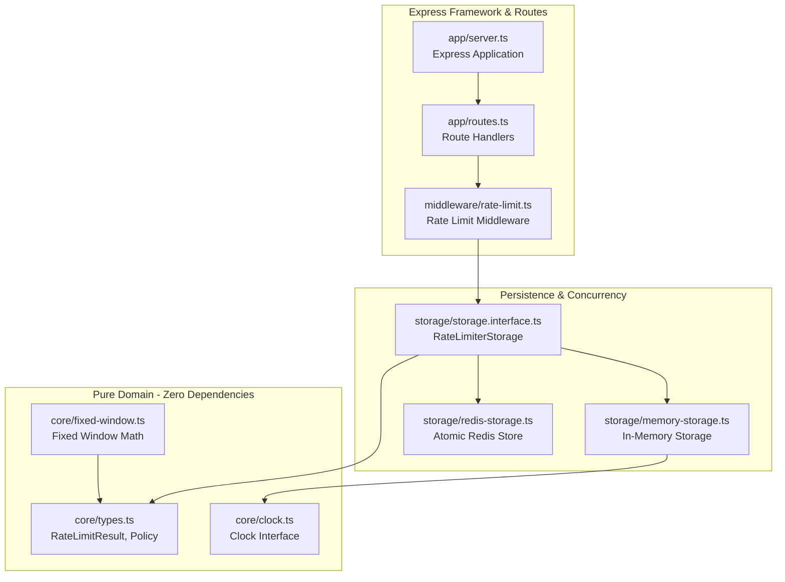
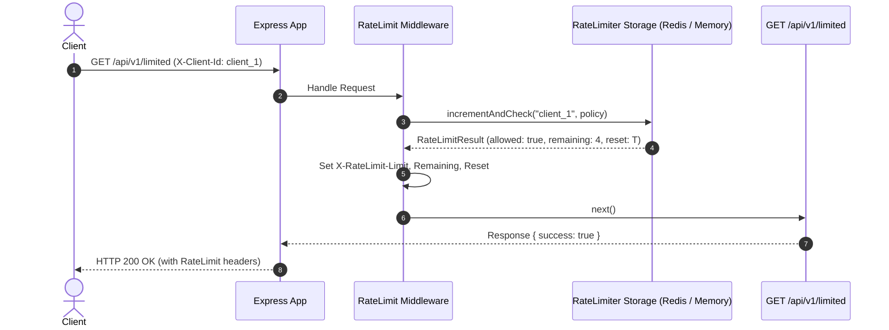
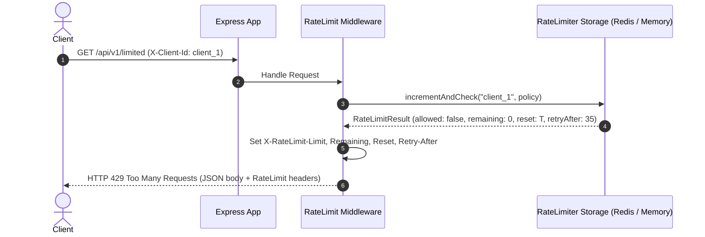
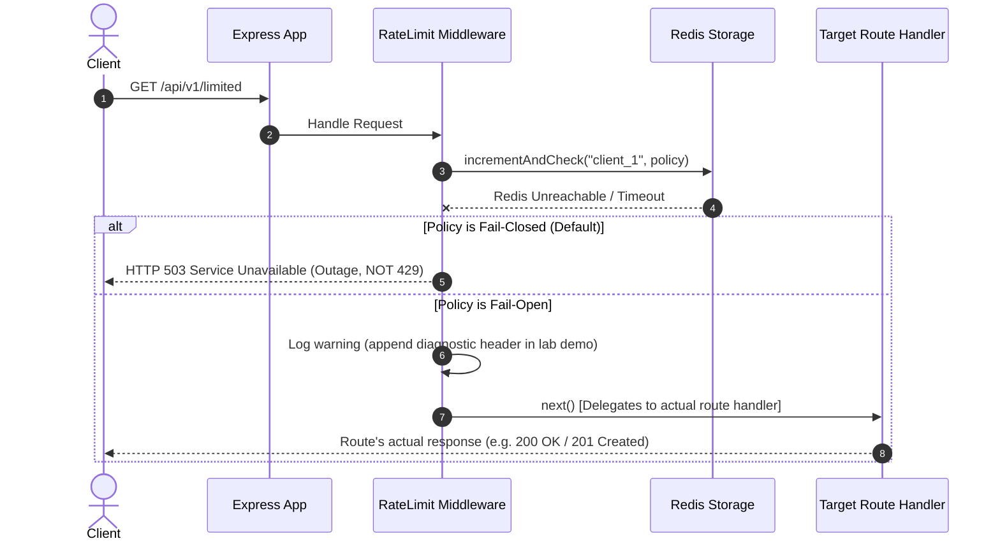

# Architecture & Module Design — Rate Limiting Laboratory

**Document Version:** 1.1.0  
**Phase:** 03.1 — Architectural Design Refinement  
**Repository:** `engineering-proof-labs/rate-limiting-lab`

---

## 1. Architectural Principles

This laboratory adheres to **focused modularity without architectural ceremony**:

1. **Core Domain Independence:** Pure rate-limiting algorithms contain zero framework dependencies (no Express, no Redis, no network).
2. **Minimal & Direct Abstractions:** No artificial micro-files or single-method wrapper classes. Functions and modules directly fulfill testable requirements.
3. **Pluggable Time for Unit Tests vs Redis Time Authority:**
   - In-memory limiters accept an explicit `Clock` interface (`VirtualClock`) for sub-millisecond, deterministic tests.
   - The distributed Redis storage uses **Redis server time** (`redis.call('TIME')`) as the single authoritative clock to prevent multi-instance clock drift.

---

## 2. Streamlined Module Map

```
src/
├── core/                       # Pure domain engine & types (zero dependencies)
│   ├── types.ts                # RateLimitResult, RateLimitPolicy, Clock
│   ├── clock.ts                # SystemClock, VirtualClock
│   └── fixed-window.ts         # Pure mathematical window calculation
│
├── storage/                    # Storage backends
│   ├── storage.interface.ts    # RateLimiterStorage interface
│   ├── memory-storage.ts       # In-memory map storage (deterministic unit testing)
│   └── redis-storage.ts        # Atomic Redis backend (anchored to Redis time)
│
├── middleware/                 # Express HTTP adapter
│   └── rate-limit.ts           # Middleware factory (includes header & error handling)
│
└── app/                        # Express application assembly
    ├── routes.ts               # Route handlers (/health, /api/v1/limited, /api/v1/unlimited)
    └── server.ts               # App factory and server listener
```

---

## 3. Module Responsibilities & Contracts



### 3.1 `core/` (Domain Engine)

- **`types.ts`:**
  ```typescript
  export interface RateLimitPolicy {
    readonly limit: number; // Total allowed requests per window (e.g. 5)
    readonly windowMs: number; // Window duration in milliseconds (e.g. 60000)
    readonly failurePolicy: 'fail-closed' | 'fail-open';
  }

  export interface RateLimitResult {
    readonly allowed: boolean; // Admission decision
    readonly limit: number; // Maximum quota for window
    readonly remaining: number; // Remaining quota (>= 0)
    readonly resetTimeMs: number; // Absolute epoch millisecond of window reset
    readonly retryAfterSeconds?: number; // Present only on HTTP 429 (quota exhaustion)
  }

  export interface Clock {
    now(): number;
  }
  ```
- **`clock.ts`:** `SystemClock` (delegates to `Date.now()`) and `VirtualClock` (supports programmatic `advance(ms)` for deterministic unit tests).
- **`fixed-window.ts`:** Computes window IDs, boundary points, and reset timestamps using pure arithmetic ($k = \lfloor t / W \rfloor$).

### 3.2 `storage/` (State & Concurrency)

- **`storage.interface.ts`:**
  ```typescript
  export interface RateLimiterStorage {
    incrementAndCheck(
      key: string,
      policy: RateLimitPolicy,
      nowMs?: number, // Used by memory-storage with VirtualClock; Redis uses server time
    ): Promise<RateLimitResult>;

    reset(key?: string): Promise<void>;
    close(): Promise<void>;
  }
  ```
- **`memory-storage.ts`:** Stores client counts in an in-memory `Map`. Ideal for sub-millisecond unit tests.
- **`redis-storage.ts`:** Executes an atomic Lua script in Redis. Calculates window boundaries using **Redis server time** (`redis.call('TIME')`), eliminating clock skew vulnerabilities across application instances.

### 3.3 `middleware/rate-limit.ts` (HTTP Adapter)

- Resolves client key from `X-Client-Id` or `req.ip`.
- Calls `storage.incrementAndCheck(key, policy, clock.now())`.
- Sets standard de facto headers (`X-RateLimit-Limit`, `X-RateLimit-Remaining`, `X-RateLimit-Reset`).
- Handles outcomes:
  - **Admitted:** Sets headers and calls `next()`.
  - **Throttled (429):** Sets headers including `Retry-After: <seconds>` and sends JSON error response.
  - **Storage Outage (Fail-Closed Default):** Returns `HTTP 503 Service Unavailable`. `Retry-After` is omitted by default to avoid misleading clients with an artificial recovery promise.
  - **Storage Outage (Fail-Open):** Logs a warning, appends optional internal test diagnostic header `X-RateLimit-Fallback: fail-open`, and calls `next()` to **delegate execution directly to the downstream route handler**.

### 3.4 `app/` (Application Wiring)

- Composes Express routes with clean prefixes:
  - `GET /health` $\rightarrow$ Unthrottled healthcheck.
  - `GET /api/v1/unlimited` $\rightarrow$ Unthrottled control route.
  - `GET /api/v1/limited` $\rightarrow$ Protected route wrapped by `rateLimitMiddleware`.

---

## 4. Sequence Diagrams

### 4.1 Admitted Request Flow



### 4.2 Throttled Request Flow (Quota Exhausted)



### 4.3 Redis Outage: Fail-Closed vs Fail-Open



---

## 5. Dependency Boundaries

1. Zero cyclic dependencies.
2. `core/` contains no external imports.
3. `storage/` depends only on `core/` and Redis driver (`ioredis`).
4. Unit tests against `core/` and `memory-storage.ts` run in $< 50\text{ms}$ with zero network or daemon requirements.
5. Integration tests against `redis-storage.ts` require a running Redis instance to validate distributed atomicity and server-time coordination.
