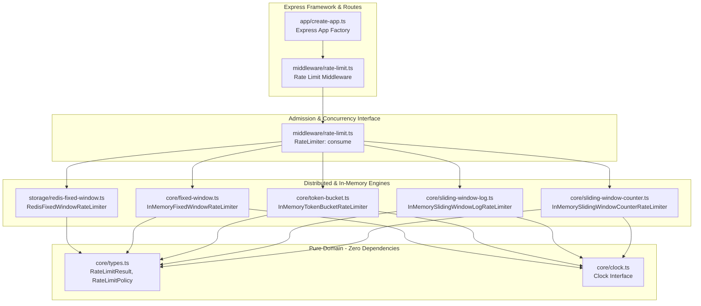
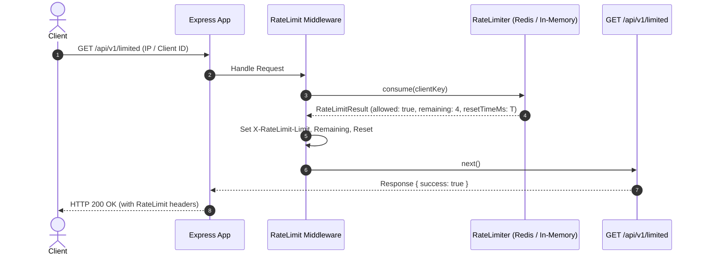
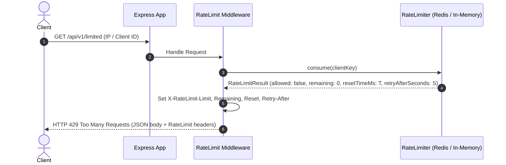
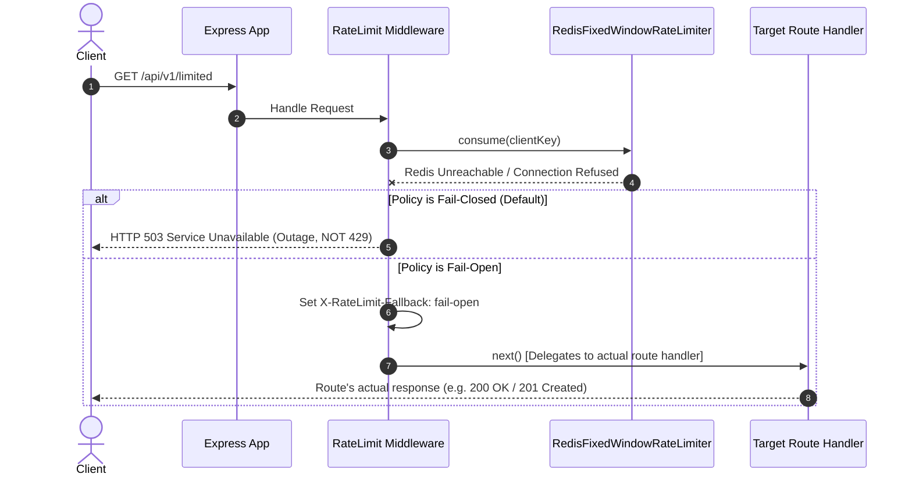

# Architecture & Module Design — Rate Limiting Laboratory

**Document Version:** 1.2.0  
**Phase:** 12 — Benchmarks, Mutations & Architectural Realignment  
**Repository:** `engineering-proof-labs/rate-limiting-lab`

---

## 1. Architectural Principles

This laboratory adheres to **focused modularity without architectural ceremony**:

1. **Core Domain Independence:** Pure rate-limiting algorithms contain zero framework dependencies (no Express, no Redis, no network).
2. **Minimal & Direct Abstractions:** No artificial micro-files or speculative wrapper classes. Rate limiters implement a unified `consume(key)` contract.
3. **Pluggable Time for Unit Tests vs Redis Time Authority:**
   - In-memory limiters accept an explicit `Clock` interface (`VirtualClock`) for sub-millisecond, deterministic tests.
   - The distributed Redis storage uses **Redis server time** (`redis.call('TIME')`) as the single authoritative clock to prevent multi-instance clock drift.

---

## 2. Streamlined Module Map

```
src/
├── core/                       # Pure domain algorithms & types (zero dependencies)
│   ├── types.ts                # RateLimitResult, RateLimitPolicy, TokenBucketPolicy, Clock
│   ├── clock.ts                # SystemClock, VirtualClock
│   ├── fixed-window.ts         # Fixed Window Counter reference implementation
│   ├── token-bucket.ts         # Token Bucket reference implementation
│   ├── sliding-window-log.ts   # Sliding Window Log reference implementation
│   └── sliding-window-counter.ts # Sliding Window Counter reference implementation
│
├── storage/                    # Distributed state & persistence
│   └── redis-fixed-window.ts   # Atomic Redis Fixed Window rate limiter (anchored to Redis time)
│
├── middleware/                 # Express HTTP adapter
│   └── rate-limit.ts           # Middleware factory, key generators, header formatting, failure policies
│
├── app/                        # Express application assembly
│   └── create-app.ts           # Application factory (/health, /api/v1/limited, /api/v1/unlimited)
│
└── index.ts                    # Laboratory entrypoint & public exports
```

---

## 3. Module Responsibilities & Contracts



### 3.1 `core/` (Domain Engine)

- **`types.ts`:**
  ```typescript
  export interface RateLimitPolicy {
    readonly limit: number; // Total allowed requests per window
    readonly windowMs: number; // Window duration in milliseconds
  }

  export interface TokenBucketPolicy {
    readonly capacity: number;
    readonly refillRate: number;
    readonly refillIntervalMs: number;
  }

  export interface RateLimitResult {
    readonly allowed: boolean; // Admission decision
    readonly limit: number; // Maximum quota for window
    readonly remaining: number; // Remaining quota (>= 0)
    readonly resetTimeMs: number; // Absolute epoch millisecond of window reset / earliest admission
    readonly retryAfterSeconds?: number; // Present only on throttled requests
  }

  export interface Clock {
    now(): number;
  }
  ```
- **`clock.ts`:** `SystemClock` (delegates to `Date.now()`) and `VirtualClock` (supports programmatic `setTime(ms)` and `advance(ms)` for deterministic unit tests).
- **Domain Implementations:**
  - `fixed-window.ts`: Pure Fixed Window counter arithmetic ($k = \lfloor t / W \rfloor$).
  - `token-bucket.ts`: Continuous refill token bucket with exact mathematical integer ordering and safe float-bound accrual.
  - `sliding-window-log.ts`: Exact sliding window log with memory bounding (rejected requests are not recorded).
  - `sliding-window-counter.ts`: Sliding window counter with continuous decay earliest-admission derivation.

### 3.2 `storage/` (Distributed State & Concurrency)

- **`redis-fixed-window.ts`:**
  - Executes an atomic Lua script inside Redis via `EVAL`.
  - Calculates window boundaries using **Redis server time** (`redis.call('TIME')`), eliminating clock skew vulnerabilities across application instances.
  - Implements `RateLimiter`:
    ```typescript
    export class RedisFixedWindowRateLimiter implements RateLimiter {
      public readonly policy: Readonly<RateLimitPolicy>;
      consume(key: string): Promise<RateLimitResult>;
      reset(key?: string): Promise<void>;
      close(): Promise<void>;
    }
    ```

### 3.3 `middleware/rate-limit.ts` (HTTP Adapter)

- Defines the cohesive consumer interface:
  ```typescript
  export interface RateLimiter {
    readonly policy: Readonly<RateLimitPolicy>;
    consume(key: string): RateLimitResult | Promise<RateLimitResult>;
  }
  ```
- Resolves client key:
  - `defaultKeyGenerator`: Strictly anchors to IP address (`req.ip ?? req.socket.remoteAddress`).
  - `demoHeaderKeyGenerator`: Validates sanitized `X-Demo-Client-Id` or `X-Client-Id` for testing fixtures.
- Sets standard de facto headers (`X-RateLimit-Limit`, `X-RateLimit-Remaining`, `X-RateLimit-Reset`).
- Handles outcomes:
  - **Admitted:** Sets headers and calls `next()`.
  - **Throttled (429):** Sets headers including `Retry-After: <seconds>` and sends JSON error response.
  - **Storage Outage (Fail-Closed Default):** Returns `HTTP 503 Service Unavailable`. `Retry-After` is omitted by default to avoid misleading clients with an artificial recovery promise.
  - **Storage Outage (Fail-Open):** Appends diagnostic header `X-RateLimit-Fallback: fail-open` and calls `next()` to **delegate execution directly to the downstream route handler**.

### 3.4 `app/create-app.ts` (Application Factory)

- Requires mandatory `limiter` instance to prevent silent unmetered route exposure.
- Mounts standard endpoints:
  - `GET /health` $\rightarrow$ Unthrottled healthcheck.
  - `GET /api/v1/unlimited` $\rightarrow$ Unthrottled control route.
  - `GET /api/v1/limited` $\rightarrow$ Protected route wrapped by `createRateLimitMiddleware`.

---

## 4. Sequence Diagrams

### 4.1 Admitted Request Flow



### 4.2 Throttled Request Flow (Quota Exhausted)



### 4.3 Storage Outage: Fail-Closed vs Fail-Open



---

## 5. Dependency Boundaries & Architectural Evolution

1. **Zero cyclic dependencies:** Verified via ESLint and TypeScript compilation.
2. **`core/` contains no external imports:** Pure domain arithmetic.
3. **Storage consolidation:** Early exploratory documents proposed abstract `storage.interface.ts` layers with `incrementAndCheck()`. In Phase 06 and Phase 07, this was streamlined directly into the `RateLimiter` interface (`consume(key)`), eliminating unnecessary intermediate layers and unifying in-memory and Redis limiters under one contract.
4. **Unit test execution:** Pure in-memory unit tests run with zero network dependencies using `VirtualClock`.
5. **Integration test execution:** Redis integration tests require a live Redis instance to validate distributed atomicity and server-time coordination.
