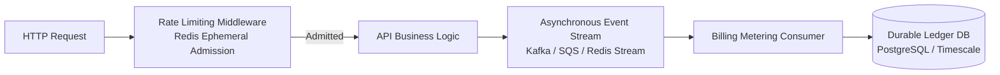

# Scenario 05: Dynamic Entitlements, Tier Upgrades & Rate Admission vs. Billing Metering

**Status:** Documented Design  
**Category:** Business Contracts & Entitlements Architecture  
**Repository:** `engineering-proof-labs/rate-limiting-lab`

---

## 1. Original System Contract & Assumptions

The laboratory implementations configure rate-limiting policies statically at application startup:

- A single policy (e.g., $L = 5\text{ req} / 60\text{s}$) applies uniformly to all callers.
- Policy parameters (`limit`, `windowMs`, `capacity`, `refillRate`) are immutable throughout process lifecycle.
- Admission decisions are treated as ephemeral operational controls without financial consequence.

---

## 2. Newly Introduced Constraint

The platform introduces a commercial, multi-tenant subscription model:

1. **Tiered Policies:** Free tenants receive 100 req/min; Premium tenants receive 5,000 req/min.
2. **Dynamic Mid-Traffic Upgrades:** A tenant upgrades from Free to Premium while active traffic is in flight. The increased quota should apply promptly without restarting application clusters.
3. **Monthly Billing Metering:** Contractual billing invoices tenants based on total billable API calls per calendar month, with financial penalties for overbilling or service credit SLA breaches.

---

## 3. Invalidated Assumptions

1. **Static Uniform Policy:** Policies cannot be compiled into application boot configuration or hardcoded in routes.
2. **Equivalence of Rate Admission and Billing Metering:** Ephemeral rate limiting counters in Redis RAM are fundamentally unsuited for durable billing reconciliation.

---

## 4. Evaluated Alternatives for Dynamic Entitlement Lookup

### Alternative A: Synchronous Billing Database Query per Request

- **Mechanism:** On every incoming HTTP request, the middleware executes a synchronous SQL query against PostgreSQL/Stripe API to fetch the tenant's current plan and quota.
- **Tradeoffs:**
  - _Advantages:_ Instantaneous reflection of plan changes (zero entitlement staleness).
  - _Disadvantages:_ Catastrophic latency and database saturation. Turns high-throughput API endpoints ($10^4\text{ req/s}$) into millions of transactional DB queries, introducing a massive availability bottleneck.

### Alternative B: Cached Entitlements with Webhook/PubSub Invalidation

- **Mechanism:** Entitlement metadata (`tenant_id -> { tier: 'premium', limit: 5000 }`) is cached in local memory or Redis with a short TTL (e.g. 5 minutes). When an upgrade occurs in the billing system, an event bus (e.g. Redis Pub/Sub, Kafka, or webhook) broadcasts an invalidation event that purges stale cache entries.
- **Tradeoffs:**
  - _Advantages:_ Sub-millisecond rate check overhead. Invalidation updates active quotas within milliseconds of subscription confirmation.
  - _Disadvantages:_ Eventual consistency window: if invalidation messages drop or lag, tenants experience a transient delay before the upgraded limit takes effect.

---

## 5. Architectural Distinction: Rate Admission vs. Billing Metering

A critical architectural anti-pattern is attempting to use the rate limiter's Redis counters as the source of truth for billing invoices. They serve fundamentally incompatible requirements:

| Dimension                  | Rate Limiting (Admission Control)                                                  | Usage Metering (Billing Reconciliation)                                    |
| :------------------------- | :--------------------------------------------------------------------------------- | :------------------------------------------------------------------------- |
| **Primary Objective**      | Protect service capacity and downstream health                                     | Generate legally binding financial invoices                                |
| **Time Horizon**           | Short rolling windows (seconds, minutes)                                           | Long billing cycles (calendar month, year)                                 |
| **Storage Engine**         | Ephemeral in-memory RAM / Redis                                                    | Durable ACID Relational Store / Event Ledger (e.g. PostgreSQL, ClickHouse) |
| **Durability Requirement** | Transient. Counter reset on Redis restart is acceptable ($< 60\text{s}$ recovery). | **Strictly Durable.** Zero data loss tolerance; write-ahead logged.        |
| **Consistency Model**      | Eventual recovery, bounded approximation acceptable                                | Strict transactional consistency and idempotency                           |
| **Audit Trail**            | None / sampling logs                                                               | Cryptographically verifiable, immutable transaction ledger                 |

---

## 6. Recommended Architecture: Two-Phase Separation

1. **Phase 1 (Edge Admission):** Ephemeral Redis rate limiter checks cached entitlement (`5000 req/min`) and admits or throttles with zero database load.
2. **Phase 2 (Asynchronous Metering):** Admitted requests emit lightweight usage events to an asynchronous log (Kafka or Redis Stream). The billing service consumes events idempotently to update durable monthly ledger accounts.

---

## 7. Expected Failure Modes & Operational Limitations

1. **Stale Cache Window:** In the event of a message bus partition, a newly upgraded user may temporarily receive HTTP 429 for up to the entitlement cache TTL.
2. **Lease Reconciliation:** Mid-window upgrades require defining rollover semantics (e.g. resetting current-window usage vs preserving consumed count toward the new ceiling).

---

## 8. Executable Acceptance Criteria (Design Scope)

1. When entitlement cache is invalidated, the next request for `tenant_id` must load the new quota from storage.
2. Storage outage in the ephemeral rate limiter must never corrupt or wipe historical monthly billing ledgers.

---

## 9. Existing Tests & Verification Paths

- In accordance with the Phase 11 specification, billing service implementation is explicitly excluded from this laboratory.
- Policy validation tests: [`tests/unit/fixed-window.test.ts`](../../tests/unit/fixed-window.test.ts), [`tests/unit/token-bucket.test.ts`](../../tests/unit/token-bucket.test.ts)

---

## 10. Implementation Status

**Label:** `documented design`
