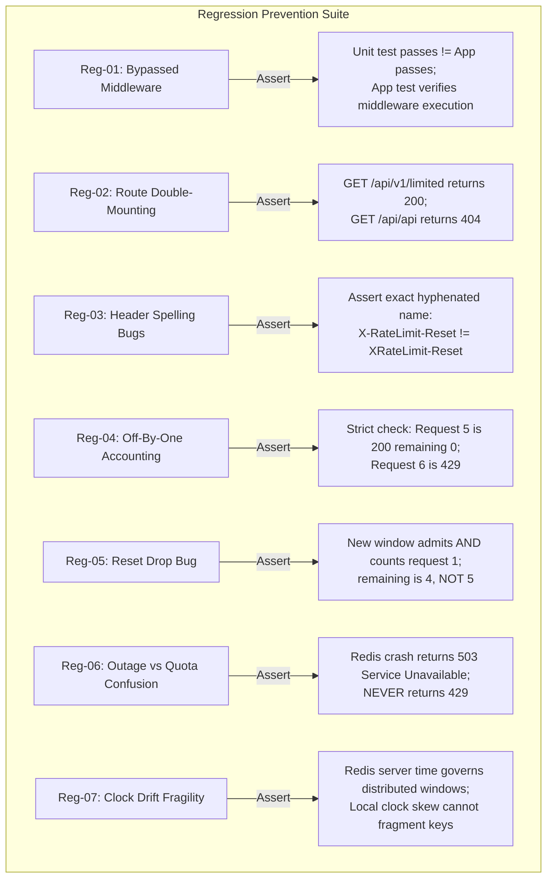

# Test Coverage & Verification Matrix — Rate Limiting Laboratory

**Document Version:** 1.2.0  
**Phase:** 05 — In-Memory Fixed Window Reference Algorithm  
**Repository:** `engineering-proof-labs/rate-limiting-lab`

---

## 1. Test Strategy Overview & Clock Boundaries

Verification is organized into three distinct tiers with clear clock boundaries:

1. **Tier 1 — In-Memory Unit Tests (`tests/unit/`):** Test pure algorithm math, window transitions, boundary points, and counter saturation using `VirtualClock`. Operates purely in-process with zero network or daemons.
2. **Tier 2 — Assembled HTTP Contract Tests (`tests/contract/`):** Test the full Express application with `supertest`. Verifies routing, middleware wiring, header formatting, fail-closed 503 behavior, and fail-open delegation. (Scheduled: Phase 07).
3. **Tier 3 — Redis Concurrency & Integration Tests (`tests/integration/`):** Requires real Redis instance. **VirtualClock does NOT control Redis time.** Uses real elapsed time (leveraging the 1,000 ms fast regression fixture) or programmatic `reset()` to verify atomic admissions and server-time coordination under concurrent load (`Promise.all`). (Scheduled: Phase 06 & Phase 08).

---

## 2. Requirements to Test Case Mapping

| ID         | Specification Requirement             | Test Tier                | Concrete Test Case Reference                                                                                           | Status                                |
| :--------- | :------------------------------------ | :----------------------- | :--------------------------------------------------------------------------------------------------------------------- | :------------------------------------ |
| **REQ-01** | Standard Quota Admission              | Unit & Contract          | `tests/unit/fixed-window.test.ts` > _"admits initial requests and decrements remaining quota down to zero"_            | **Verified** (Unit)                   |
| **REQ-02** | Exact 5-Request Boundary & Saturation | Unit & Contract          | `tests/unit/fixed-window.test.ts` > _"rejects the 6th request with HTTP 429 semantics"_ & _"saturates the counter..."_ | **Verified** (Unit)                   |
| **REQ-03** | Window Transition & Counting          | Unit                     | `tests/unit/fixed-window.test.ts` > _"admits and counts the first request at the exact window boundary"_               | **Verified** (Unit)                   |
| **REQ-04** | Client Key Isolation                  | Unit & Contract          | `tests/unit/fixed-window.test.ts` > _"maintains strict isolation between different client identifiers"_                | **Verified** (Unit)                   |
| **REQ-05** | Header Field Existence & Casing       | Contract                 | `tests/contract/headers.test.ts` (Phase 07)                                                                            | Pending Phase 07                      |
| **REQ-06** | Header Misspelling Prevention         | Contract                 | `tests/contract/headers.test.ts` (Phase 07)                                                                            | Pending Phase 07                      |
| **REQ-07** | `Retry-After` Emission Condition      | Contract                 | `tests/contract/headers.test.ts` (Phase 07)                                                                            | Pending Phase 07                      |
| **REQ-08** | Route Mounting & Double-Prefix Guard  | Contract                 | `tests/contract/routes.test.ts` (Phase 07)                                                                             | Pending Phase 07                      |
| **REQ-09** | Unthrottled Route Immunity            | Contract                 | `tests/contract/routes.test.ts` (Phase 07)                                                                             | Pending Phase 07                      |
| **REQ-10** | Healthcheck Immunity                  | Contract                 | `tests/contract/routes.test.ts` (Phase 07)                                                                             | Pending Phase 07                      |
| **REQ-11** | Fail-Closed Policy on Redis Outage    | Contract & Integration   | `tests/contract/outage.test.ts` (Phase 07 & 08)                                                                        | Pending Phase 07/08                   |
| **REQ-12** | Fail-Open Policy on Redis Outage      | Contract & Integration   | `tests/contract/outage.test.ts` (Phase 07 & 08)                                                                        | Pending Phase 07/08                   |
| **REQ-13** | Distributed Concurrency Safety        | Integration (Real Redis) | `tests/integration/concurrency.test.ts` (Phase 06 & 08)                                                                | Pending Phase 06/08                   |
| **REQ-14** | Fast Regression Fixture (1,000 ms)    | Unit & Integration       | `tests/unit/fixed-window.test.ts` (Unit verified) & `tests/integration/` (Phase 06)                                    | **Verified** (Unit) / Pending (Redis) |
| **REQ-15** | Redis Server Time Coordination        | Integration (Real Redis) | `tests/integration/redis-time.test.ts` (Phase 06)                                                                      | Pending Phase 06                      |

> [!NOTE]
> **Boundary Notice:** Passing Tier 1 in-memory tests proves mathematical algorithm correctness and state transitions for single-process Node.js execution. It does **not** prove distributed race safety or durability across a multi-instance Redis cluster.

---

## 3. Regression Scenarios Specifically Guarded

---

## 4. Test Execution Profiles & Toolchain Requirements

- **Runner:** Vitest (fast native ESM execution).
- **HTTP Engine:** Supertest against assembled Express app (scheduled Phase 07).
- **Clock Mocking:** Explicit dependency injection of `VirtualClock` for in-memory algorithm tests only.
- **Redis Fixture:** Docker container (`redis:7-alpine`) on `localhost:6379`. Tests skip or fail gracefully with clear diagnostics if Redis daemon is not detected.
